<p align="center">
  
</p>

<p align="center">
  <a href="https://my-portfolio2-gold-delta.vercel.app/"></a>
  <a href="https://www.linkedin.com/in/muhammad-adeel-b4874033a/"></a>
  <a href="mailto:adeelthana122@gmail.com"></a>
</p>

<p align="center">
  <a href="#about">About</a> &nbsp;·&nbsp;
  <a href="#current-work">Current Work</a> &nbsp;·&nbsp;
  <a href="#featured-projects">Projects</a> &nbsp;·&nbsp;
  <a href="#tech-stack">Tech Stack</a> &nbsp;·&nbsp;
  <a href="#github-activity">Activity</a> &nbsp;·&nbsp;
  <a href="#contact">Contact</a>
</p>

<h2><a id="about"></a></h2>


```text
$ whoami
muhammad-adeel

$ cat profile.txt
role        Full-Stack Developer
now         Real-world projects @ itShifts Technologies
studying    Software Engineering @ COMSATS University Islamabad
also        Freelancer
```

I build **full-stack web applications**, **AI-powered products**, and **mobile apps**, and I like taking a project from architecture all the way to cloud deployment.

<table>
  <tr>
    <td width="50%" valign="top">
      <b>Full-Stack Web</b><br>
      React · Next.js · Node.js · Ruby on Rails
    </td>
    <td width="50%" valign="top">
      <b>AI-Powered Apps</b><br>
      CNN / YOLO · Computer Vision · Image Classification
    </td>
  </tr>
  <tr>
    <td width="50%" valign="top">
      <b>Mobile Development</b><br>
      Flutter · Dart
    </td>
    <td width="50%" valign="top">
      <b>Backend &amp; Cloud</b><br>
      Backend Architecture · Cloud Deployment
    </td>
  </tr>
</table>

<h2><a id="current-work"></a></h2>


> [!TIP]
> **Now working at itShifts Technologies** on real-world projects, applying full-stack, AI, and cloud skills in a professional setting.

> [!NOTE]
> **Learning right now:** Backend Architecture patterns · Cloud Deployment workflows · TensorFlow and advanced AI / ML applications

<h2><a id="featured-projects"></a></h2>


<table>
  <tr>
    <td width="50%" valign="top">
      <h3>GreenBin Genius</h3>
      <br><br>
      AI-powered smart waste sorting app for web and mobile.<br><br>
      <b>Focus:</b> AI Integration · Image Classification · Full-Stack Architecture
    </td>
    <td width="50%" valign="top">
      <h3>GDSC Nexus</h3>
      <br><br>
      Community and event management platform.<br><br>
      <b>Focus:</b> Backend Architecture · Full-Stack Architecture · Cloud Deployment
    </td>
  </tr>
</table>

<p align="center">
  <a href="https://github.com/Muhammad-Adeel11?tab=repositories"></a>
</p>

<h2><a id="tech-stack"></a></h2>


| | |
| :--- | :--- |
| **Languages** |         |
| **Web** |      |
| **Mobile** |   |
| **Databases** |     |
| **ML & AI** |    |
| **Tools** |     |
| **Design** |  |

**Machine learning specialization**

   

<h2><a id="github-activity"></a></h2>


<picture>
  <source media="(prefers-color-scheme: dark)" srcset="https://raw.githubusercontent.com/Muhammad-Adeel11/Muhammad-Adeel11/output/pacman-contribution-graph-dark.svg">
  <source media="(prefers-color-scheme: light)" srcset="https://raw.githubusercontent.com/Muhammad-Adeel11/Muhammad-Adeel11/output/pacman-contribution-graph.svg">
  
</picture>

<p align="center">
  
</p>

<h2><a id="contact"></a></h2>


<p align="center">
  <a href="mailto:adeelthana122@gmail.com">
    
  </a>
</p>
<p align="center">
  <a href="https://www.linkedin.com/in/muhammad-adeel-b4874033a/"></a>
  <a href="https://github.com/Muhammad-Adeel11"></a>
  <a href="https://my-portfolio2-gold-delta.vercel.app/"></a>
</p>

<p align="center">
  
</p>


